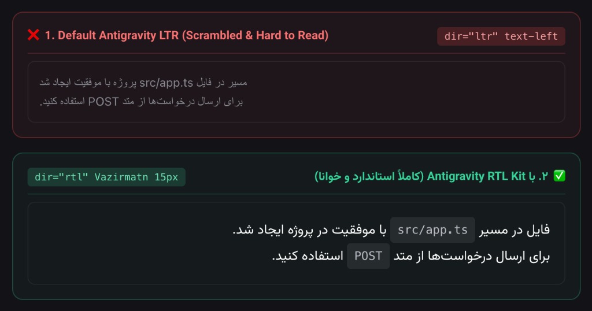
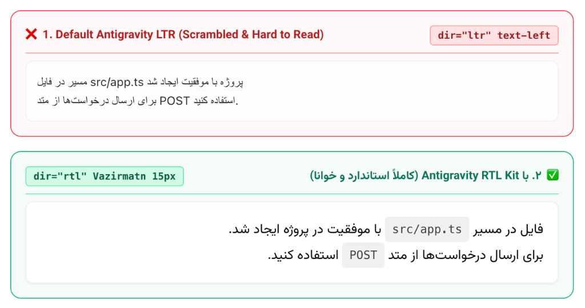

# Antigravity RTL Kit 🇮🇷 🇸🇦

[](LICENSE)
[](https://antigravity.google)
[](https://github.com/rastikerdar/vazirmatn)
[](#contributing)
[](#راهنمای-فارسی-persian-documentation)

> **Zero-configuration Right-to-Left (RTL) display kit for Google Antigravity & Gemini agents.**  
> Solves scrambled bidirectional text, thin unreadable fallback fonts, dark mode contrast issues, and LTR container bugs in 10 seconds.

---

## 🌟 The Problem

Google Antigravity and Gemini CLI environments render chat outputs inside a default **Left-to-Right (LTR)** container. For Persian (Farsi) and Arabic developers, this causes several frustrating issues:

1. **Scrambled BiDi Text:** When Persian prose is mixed with English technical terms, paths, or acronyms (e.g., `MVP`, `API`, `src/config.json`), sentences flip backwards and words appear out of order.
2. **Unreadable Fallback Fonts:** Chromium/macOS fallbacks (such as `Geeza Pro` at `12px`) render thin, faint, and cramped, straining eyes especially in dark mode.
3. **CSP Blocking:** Google Antigravity enforces a strict Content Security Policy (CSP), blocking external web fonts like `fonts.googleapis.com`.
4. **Scrambled Artifact Summaries:** Antigravity's built-in `ArtifactMetadata.Summary` cards are hard-coded in an LTR container; putting Persian text in them scrambles parentheses and acronyms.

### Visual Comparison

<!-- GitHub Native Theme Auto-Switch: displays Dark in dark mode, Light in light mode -->
<p align="center">
  
  
</p>

<details>
<summary><b>🔍 View Both Themes (Dark & Light)</b></summary>
<br>

#### 🌙 Dark Theme
<p align="center">
  
</p>

#### ☀️ Light Theme
<p align="center">
  
</p>

</details>

---

## 🚀 Quick Start (1-Liner)

Install the global rule across all your Antigravity workspaces with a single command:

```bash
curl -fsSL https://raw.githubusercontent.com/ahmadazimi/antigravity-rtl-kit/main/install.sh | bash
```

*Supports macOS and Linux.*

---

## 📦 What's Inside

```text
antigravity-rtl-kit/
├── README.md                      # Comprehensive bilingual documentation
├── LICENSE                        # MIT License
├── install.sh                     # Idempotent Bash installer (macOS & Linux)
├── uninstall.sh                   # Clean uninstaller
├── rules/
│   └── persian-rtl.md             # The core always_on Antigravity rule
├── templates/
│   ├── inline-card-boilerplate.html   # Compact (<450px) chat card boilerplate
│   └── full-report-boilerplate.html   # Standalone full-page report boilerplate
├── examples/
│   ├── sample-chat-card.html      # Real-world chat response card example
│   └── sample-report.html         # Full analytics report with tables & metrics
└── scripts/
    └── verify_setup.sh            # Environment & font diagnostic tool
```

---

## ⚙️ Manual Installation

If you prefer installing manually without running the script:

### Option A: Global Installation (Recommended)
Applies automatically to **all** your Antigravity and Gemini agent conversations:

```bash
mkdir -p ~/.gemini/config/rules
cp rules/persian-rtl.md ~/.gemini/config/rules/persian-rtl.md
```

### Option B: Workspace-Only Installation
Applies only to the current project:

```bash
mkdir -p .agents/rules
cp rules/persian-rtl.md .agents/rules/persian-rtl.md
```

---

## 🔤 Recommended Typography (Vazirmatn)

The rule uses a robust local font stack:
```css
font-family: "Vazirmatn", "Vazir", Tahoma, system-ui, -apple-system, sans-serif;
```

While systems will fall back to `Tahoma` or `system-ui` gracefully, installing the open-source **[Vazirmatn font](https://github.com/rastikerdar/vazirmatn)** provides the best visual experience:

- **macOS (Homebrew):**
  ```bash
  brew install --cask font-vazirmatn
  ```
- **Debian / Ubuntu:**
  ```bash
  sudo apt-get install fonts-vazirmatn
  ```
- **Manual Download:** [Download from GitHub Releases](https://github.com/rastikerdar/vazirmatn/releases).

---

## 🧠 How It Works: The 4 Pillars

| Pillar | Implementation | Why It Matters |
| :--- | :--- | :--- |
| **1. Native Generative UI** | `<agent-embed src="file:///<path>">` | Bypasses the LTR chat markdown container by embedding a sandboxed RTL HTML iframe. |
| **2. 15px Typography** | `text-[15px] leading-[1.9]` | Antigravity defaults to `12px` (`text-xs`), which is illegible for Arabic-script characters. `15px` provides optimal legibility. |
| **3. BiDi Token Isolation** | `unicode-bidi: isolate; direction: ltr;` | Prevents English terms, file paths, and slash commands from scrambling Persian word order. |
| **4. Strict High Contrast** | `text-[var(--foreground)]` | Bypasses `--muted-foreground` which renders too dim on dark theme backgrounds. |

---

## 🔍 Verifying Your Setup

Run the included verification script to check your font installation, active rule paths, and Antigravity directory:

```bash
./scripts/verify_setup.sh
```

Example output:
```text
=== Antigravity RTL Verification ===

[1/4] Operating System: Darwin (arm64)
[2/4] Typography & Font Verification:
  ✓ Vazirmatn is installed: Homebrew Cask (font-vazirmatn)
[3/4] Antigravity Rules Check:
  ✓ Global Rule Active & Valid: ~/.gemini/config/rules/persian-rtl.md
[4/4] Environment Check:
  ✓ Antigravity App Data directory detected: ~/.gemini/antigravity

=== Verification Summary ===
✓ Perfect! Your Antigravity RTL Persian environment is completely configured.
```

---

## ❓ Frequently Asked Questions (FAQ)

### What about the Antigravity chat input box?
This repository configures the **AI agent's output rendering** inside the IDE chat and artifact drawer.  
To also make your **user input textarea** type right-to-left in the IDE, pair this with community VS Code / Antigravity extensions such as:
- `FAntigravity-IDE-RTL-Persian-Arabic`
- `vscode-antigravity-rtl`

### Why does the rule instruct `ArtifactMetadata.Summary` to stay in English?
Antigravity's system artifact card drawer (the collapsible card at the bottom of agent messages) is rendered natively in a rigid LTR container. Writing Persian text in `ArtifactMetadata.Summary` scrambles parenthesized acronyms and paths. Writing a concise English summary keeps the system card neat, while the actual report/card opens in gorgeous full-native RTL.

### Are external CDNs allowed?
No. Antigravity enforces strict CSP blocking of `fonts.googleapis.com` or arbitrary CDN scripts. This kit only uses the pre-approved Tailwind CDN (`https://www.gstatic.com/antigravity/web/dev/tailwindcss.min.js`) and relies entirely on local system font stacks.

---

## 🗑️ Uninstallation

To remove the rules cleanly at any time:

```bash
# Remove global or workspace rules automatically
./uninstall.sh

# Or remove manually:
rm -f ~/.gemini/config/rules/persian-rtl.md
rm -f .agents/rules/persian-rtl.md
```

---

<div dir="rtl">

# راهنمای فارسی (Persian Documentation)

### بسته ابزار نمایش راست‌به‌چپ (Antigravity RTL Kit)

این مخزن راهکاری جامع، استاندارد و بدون نیاز به دستکاری کدهای هسته برای حل مشکل نمایش متون فارسی در محیط هوش مصنوعی **Google Antigravity** و **Gemini CLI** ارائه می‌دهد.

### مشکلات برطرف‌شده:
1. **به‌هم‌ریختگی متن دوزبانه (BiDi):** ترکیب کلمات انگلیسی، مسیر فایل‌ها و اصطلاحات تخصصی با متن فارسی دیگر باعث جابه‌جایی و وارونگی جملات نخواهد شد.
2. **فونت ناخوانا در حالت تاریک:** جایگزینی فونت‌های پیش‌فرض باریک و ریز سیستم‌عامل با چینش فونت استاندارد **وزیرمتن (Vazirmatn)** و اندازه بهینه `15px`.
3. **رعایت محدودیت‌های امنیتی (CSP):** کلیه قالب‌ها بدون نیاز به لود فونت از سرورهای گوگل و با رعایت کامل امنیت داخلی آنتی‌گرویتی طراحی شده‌اند.

### نصب سریع (تنها با یک دستور در ترمینال):
```bash
curl -fsSL https://raw.githubusercontent.com/ahmadazimi/antigravity-rtl-kit/main/install.sh | bash
```

### نصب دستی:
فایل قانون `rules/persian-rtl.md` را در مسیر سراسری قوانین آنتی‌گرویتی کپی کنید:
```bash
mkdir -p ~/.gemini/config/rules
cp rules/persian-rtl.md ~/.gemini/config/rules/persian-rtl.md
```

پس از کپی این فایل، ایجنت هوش مصنوعی در تمامی گفتگوها و پروژه‌های شما به‌صورت خودکار پاسخ‌های فارسی را داخل کارت‌های شکیل و خوانای راست‌به‌چپ ارائه خواهد کرد.

### بررسی سلامت نصب:
برای اطمینان از نصب بودن فونت وزیرمتن و صحت فایل‌های تنظیمات:
```bash
./scripts/verify_setup.sh
```

</div>

---

## 📄 License

Distributed under the [MIT License](LICENSE).
